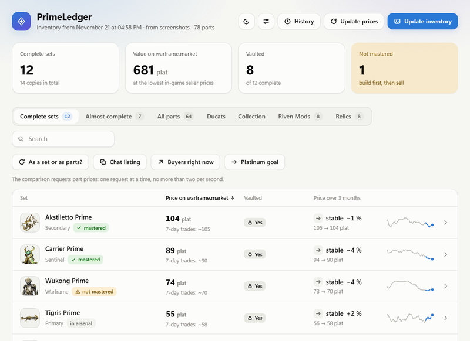
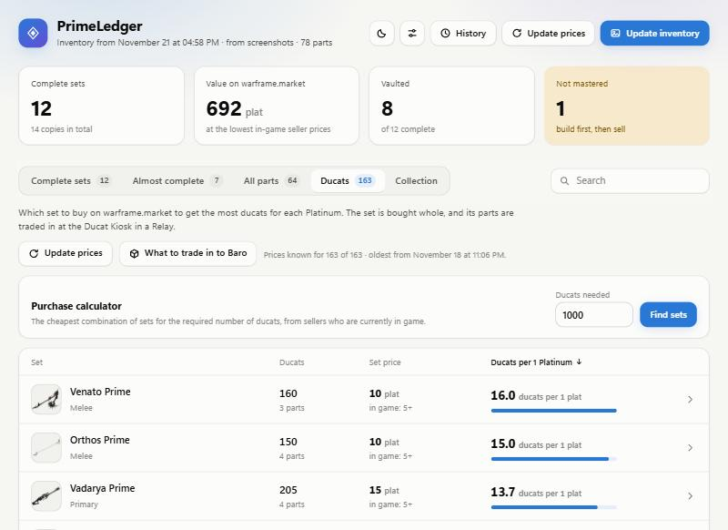
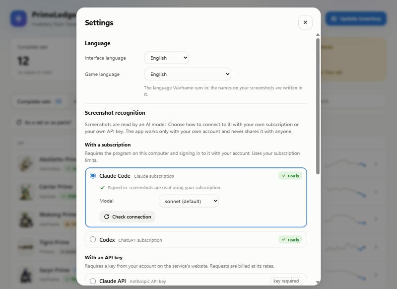

# PrimeLedger — Prime sets for Warframe

*[Русская версия](README.ru.md)*

A small Windows app that turns screenshots of your Prime parts into a list of the sets you can
sell, with live prices from warframe.market.



- **Complete sets** — price on warframe.market, whether the set is vaulted, the 90-day price trend,
  and a warning when you have not mastered the item yet.
- **Almost complete** — which parts are missing and what they cost.
- **Ducats** — which sets give the most ducats per platinum, and a purchase calculator that picks
  the cheapest sets from sellers who are in the game right now and writes the message for each of them.
- **History** — what changed after every update of your inventory, and what your sets are worth over time.
- **Selling help** — "as a set or as parts?" and a ready listing for the trade chat.

Interface languages: English, Русский, Deutsch, Français, Polski, 简体中文.



The app never connects to the game. It works with pictures you took yourself and with public
data (the warframe.market API and the official Digital Extremes drop tables).

## Download and run

1. Take `PrimeLedger.exe` from the [Releases page](https://github.com/nazdrec/PrimeLedger/releases) and start it. Nothing needs to be installed;
   the window opens in Microsoft Edge or Chrome app mode (one of them must be present, as it is
   on Windows 10/11).
2. The exe is not code-signed, so Windows SmartScreen may show "Windows protected your PC" on the
   first start: choose *More info → Run anyway*. Some antivirus programs are suspicious of any
   packed Python program; you can build the exe yourself from this source (see below).
3. On the first start the app downloads the list of Prime sets from warframe.market (about a minute and a half).

Your data (inventory, settings, cache) lives in `%LOCALAPPDATA%\PrimeLedger`. To keep it next to the
exe instead (a portable copy), create a folder named `data` beside `PrimeLedger.exe` before the first start.

## Connect the AI that reads your screenshots

Screenshots are read by an AI model, and you choose how to reach it: **Settings** (the sliders
button at the top) → *Screenshot recognition*. Every person connects **their own** account — nothing is shared
and nothing is built into the app.



| Connection | What you need | Cost |
|---|---|---|
| **Claude Code** (subscription) | [Claude Code](https://claude.com/claude-code) installed and signed in with your Claude account | uses the limits of your subscription |
| **Codex** (subscription) | the Codex app or CLI installed and signed in with your ChatGPT account | uses the limits of your subscription |
| **Claude API** | an Anthropic API key | pay per request |
| **OpenAI API** | an OpenAI API key | pay per request |
| **DeepSeek API** | a DeepSeek API key | pay per request |
| **Gemini API** | a Google AI Studio API key | pay per request |

- For the subscription options the app starts the program that is already on your computer and
  never sees your password; the *Sign in* button opens that program's own sign-in.
- An API key is typed into the settings once. It is stored on your computer only, encrypted with
  your Windows account (DPAPI); it is never shown again, never written to the log and never sent
  anywhere except to the service it belongs to.
- If a service cannot be reached from your network, set an HTTP proxy in the settings and switch
  it on for that connection.
- *Check connection* asks the service for its list of models: free of charge, and it tells you
  whether the key works.

**What has been tested.** Reading through Claude Code was checked on real screenshots (Russian
client, 2560×1440: 51 screenshots, every part matched). The other five connections are covered by
automated tests against the documented request and answer formats, but have not been run against
real accounts yet, and game clients in languages other than Russian have not been tried on real
screenshots either. If something reads wrong, please [open an issue](https://github.com/nazdrec/PrimeLedger/issues) with the screenshot.

## Update your inventory

1. In the game open *Inventory → Sell*, choose the *Prime Parts* category (or search for "prime")
   and press **F6** on every screen of the list. Scroll three rows at a time: the cut-off bottom
   row must become the top row. Keep the cursor to the right of the list. The game saves the
   screenshots to `Pictures\Warframe` by itself. The Foundry (search "prime") needs to be shot
   only once — it is used just for the "Mastered" marks.
2. In the app open **Update inventory** and press **Add**: it finds the new game screenshots.
   You can also paste a screenshot with **Ctrl+V** anywhere in the window, drag files in, or pick them.
3. The app compares neighbouring screenshots at once. If you scrolled more than three rows it shows
   between which screenshots the list does not join (they are outlined in red); go back to that
   place in the game, press F6 again and add the screenshot — the order does not matter. It also
   warns when the list was not shot from its start or to its end.
4. Press **Recognize**. Check what was found and press *Add to Inventory*. In the "This is my whole
   list" mode you see which parts would disappear before anything is written.

Any number can be corrected by hand on the *All parts* tab, and a mastery mark by clicking it.

## Why this does not break the rules

- The app **does not touch the game**: it does not read its memory, does not intercept traffic,
  does not call its servers and presses nothing in it. The game can be closed.
- It works only with pictures you made yourself and with public data: the public warframe.market
  API and the official drop tables page of Digital Extremes.
- Requests to warframe.market go one at a time, at most two per second (the site allows three),
  and answers are cached. The app places no orders and sends nothing to the game chat: messages
  to sellers are copied by you. A message keeps the site's own format and names the app, as the
  site's API rules ask.
- When Claude Code or Codex reads a screenshot it runs in a restricted mode: it can only look at
  the pictures in a temporary folder, cannot run commands and cannot reach other files.

Digital Extremes' position on third-party software is that any of it is used at your own risk;
read it yourself: [Third-Party Software and You](https://support.warframe.com/hc/en-us/articles/360030014351-Third-Party-Software-and-You),
[EULA](https://www.warframe.com/eula). warframe.market: [Terms of Service, section 11 "API"](https://warframe.market/tos).

This project is not affiliated with Digital Extremes or warframe.market.

## How the numbers are made

- **Price** — the lowest sell price of the whole set among players who are in the game right now (PC).
- **Price over 3 months** — closed deals of the last 90 days: the average of the first 14 days
  against the last 14; a change under 10 % counts as stable.
- **Vaulted** — "yes" when no relic with the set's parts drops in missions now (official drop tables).
- **Complete set** — by the set's composition on warframe.market: a part needed twice is counted twice.
- **Ducats per platinum** — the ducats of all parts of a set divided by the price of its cheapest in-game seller.
- **Mastery** — only from your screenshots or your own marks: Digital Extremes has no public account data.

The same explanations are in the app, under *How it is calculated and where the data comes from*.

## Run from source, build the exe

Python 3.11+ on Windows.

```powershell
pip install -r requirements.txt
```

```powershell
python app.py
```

```powershell
python -m unittest discover -s tests
```

```powershell
python tools/build_exe.py
```

The build creates its own environment in `.build/venv`, makes `dist/PrimeLedger.exe` and then opens
the exe to check that nothing but the program is inside (no data, no settings, no keys).
`python tools/release_check.py` lists what would be published and looks for personal data in it;
`python tools/make_release.py` collects the files of the repository and the exe in `release/`.

## Translations

The texts are written in Russian in the code and translated in `web/i18n/<lang>.json`. The
translations were made by an AI model and have not been reviewed by native speakers — corrections
are welcome. `python tools/i18n_keys.py` shows missing or broken entries.

## License

[MIT](LICENSE). The exe also contains Python and a few libraries under their own licenses; their
texts are packed into it and shown in the app: *Settings → Licenses*.
