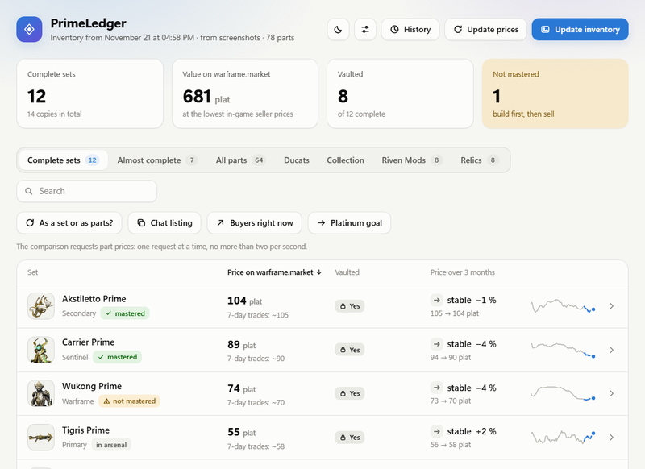
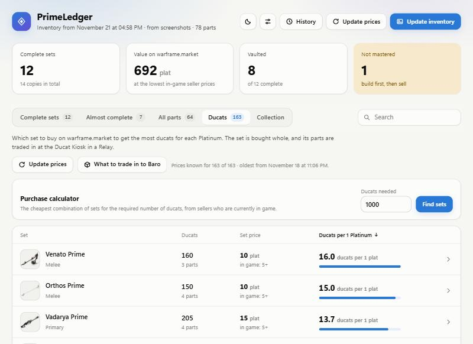
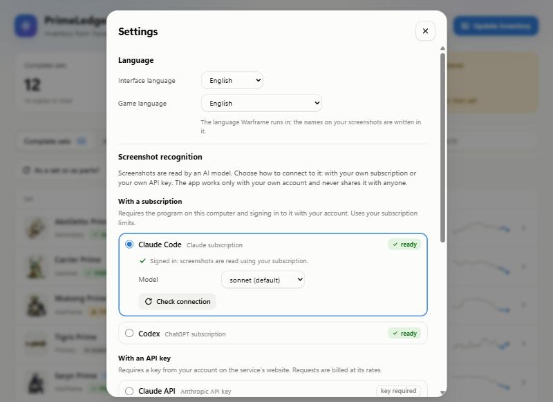

# PrimeLedger — прайм-комплекты Warframe

*[English version](README.md)*

Небольшое приложение для Windows: по скриншотам ваших прайм-частей составляет список комплектов,
которые можно продать, и показывает живые цены с warframe.market.



- **Готовые комплекты** — цена на warframe.market, в хранилище ли комплект, тренд цены за 90 дней
  и предупреждение, если предмет у вас ещё не освоен.
- **Почти собраны** — каких частей не хватает, сколько они стоят и кто их продаёт: три самых
  дешёвых продавца каждой части, которые сейчас в игре, и готовое сообщение каждому. Купили
  часть — одна кнопка заносит её в инвентарь.
- **Дукаты** — какие комплекты дают больше всего дукатов за платину, и калькулятор закупки:
  подбирает самые дешёвые комплекты у продавцов, которые сейчас в игре, и готовит сообщение каждому.
  И в обратную сторону — «Что сдать Баро»: какие ваши лишние части выгоднее сдать на дукаты, а какие продать.
- **Помощь с продажей** — «комплектом или по частям?», готовое объявление для торгового чата,
  покупатели, которые прямо сейчас в игре, и «Цель по платине»: что продать, чтобы получить нужную сумму.
- **«Продал»** — одна кнопка убирает части проданного комплекта из инвентаря и записывает сделку
  в журнал, так что список остаётся верным между съёмками.
- **Коллекция** — все прайм-комплекты разом: что освоено, что собрано, что начато.
- **История** — что изменилось после каждого обновления инвентаря, сколько стоят ваши комплекты
  со временем и сколько вы заработали на продажах.
- **Съёмка с подсказками** — пока вы листаете инвентарь и нажимаете F6, приложение само забирает
  снимки и звуком сообщает, если пропущен ряд.

Посмотреть на программу можно и без своего инвентаря: при первом запуске она предложит выдуманный пример.

Языки интерфейса: русский, English, Deutsch, Français, Polski, 简体中文.



К игре приложение не подключается. Оно работает с картинками, которые вы сделали сами, и с
открытыми данными (API warframe.market и официальные таблицы дропа Digital Extremes).

## Скачать и запустить

1. Возьмите `PrimeLedger.exe` со [страницы Releases](https://github.com/nazdrec/PrimeLedger/releases) и запустите. Устанавливать ничего не нужно;
   окно открывается в Microsoft Edge или Chrome в режиме приложения (один из них должен быть на
   компьютере — в Windows 10/11 он есть).
2. У exe нет цифровой подписи, поэтому при первом запуске Windows SmartScreen может показать
   «Система Windows защитила ваш компьютер»: нажмите *Подробнее → Выполнить в любом случае*.
   Некоторые антивирусы настороженно относятся к любым упакованным программам на Python; exe
   можно собрать самому из этих исходников (см. ниже).
3. При первом запуске приложение скачивает список прайм-комплектов с warframe.market (около полутора минут).

Ваши данные (инвентарь, настройки, кэш) лежат в `%LOCALAPPDATA%\PrimeLedger`. Чтобы они хранились
рядом с exe (переносная копия), до первого запуска создайте рядом с `PrimeLedger.exe` папку `data`.

## Подключить нейросеть, которая читает скриншоты

Скриншоты читает нейросеть, а как к ней подключиться, выбираете вы: **Настройки** (кнопка с
ползунками вверху) → *Распознавание скриншотов*. Каждый подключает **свой** аккаунт — ничего
общего в приложение не встроено и никому не передаётся.



| Подключение | Что нужно | Оплата |
|---|---|---|
| **Claude Code** (подписка) | установленный [Claude Code](https://claude.com/claude-code) и вход в него своим аккаунтом Claude | лимиты вашей подписки |
| **Codex** (подписка) | установленное приложение Codex или Codex CLI и вход своим аккаунтом ChatGPT | лимиты вашей подписки |
| **Claude API** | API-ключ Anthropic | за каждый запрос |
| **OpenAI API** | API-ключ OpenAI | за каждый запрос |
| **DeepSeek API** | API-ключ DeepSeek | за каждый запрос |
| **Gemini API** | API-ключ Google AI Studio | за каждый запрос |

- По подписке приложение запускает программу, которая уже стоит на вашем компьютере, и пароля
  не видит: кнопка *Войти* открывает собственный вход этой программы.
- API-ключ вводится в настройках один раз. Он хранится только на вашем компьютере, зашифрованный
  под вашей учётной записью Windows (DPAPI); больше он не показывается, в журнал не пишется и
  никуда, кроме своего сервиса, не отправляется.
- Если сервис недоступен из вашей сети напрямую, укажите в настройках HTTP-прокси и включите
  его для нужного подключения.
- *Проверить подключение* запрашивает у сервиса список моделей: это бесплатно и сразу видно,
  работает ли ключ.

**Что проверено.** Чтение через Claude Code проверено на настоящих скриншотах (русский клиент,
2560×1440: 51 скриншот, совпали все части). Остальные пять подключений покрыты автоматическими
тестами по документированным форматам запросов и ответов, но с настоящими аккаунтами ещё не
запускались; клиенты игры на других языках на настоящих скриншотах тоже не проверялись. Если
что-то читается неверно — [заведите issue](https://github.com/nazdrec/PrimeLedger/issues) и приложите скриншот.

## Как обновить инвентарь

1. В игре откройте *Инвентарь → Продать*, выберите категорию *Прайм части* (или наберите в
   поиске «прайм») и на каждом экране списка нажмите **F6**. Листайте по три ряда: обрезанный
   нижний ряд должен стать верхним. Курсор держите справа от списка. Игра сама сохраняет снимки
   в `Изображения\Warframe`. Кузницу (поиск «прайм») достаточно снять один раз — она нужна только
   ради отметок «Освоено».
2. В приложении откройте **Обновить инвентарь** и нажмите **Добавить** — оно само найдёт новые
   снимки игры. Другие способы: **Ctrl+V** в любом месте окна, перетаскивание файлов или выбор файлов.
3. Приложение сразу сверит соседние снимки. Если где-то пролистано больше трёх рядов, оно покажет,
   между какими снимками список не стыкуется (они обведены красным): вернитесь в игре к этому
   месту, нажмите F6 ещё раз и добавьте снимок — порядок не важен. Так же оно предупредит, если
   список снят не с начала или не до конца.
4. Нажмите **Распознать**. Проверьте, что найдено, и нажмите *Занести в инвентарь*. В режиме
   «Это весь мой список» перед записью видно, какие части исчезнут из инвентаря. У строк, в
   которых приложение не уверено, показана плитка, с которой они прочитаны: количество и название
   можно поправить тут же.

**Съёмка с подсказками.** В том же окне нажмите *Включить подсказки* и переходите в игру. После каждого
F6 приложение само забирает снимок и проверяет, стыкуется ли он с предыдущим: короткий сигнал —
всё в порядке, три низких — пропущен ряд, вернитесь на один экран и нажмите F6 ещё раз. Звук
можно отключить.

Любое количество можно поправить вручную на вкладке *Все части*, отметку освоения — щелчком по ней.
Проданный комплект проще всего списать кнопкой *Продал…* в его строке.

## Почему это не нарушает правила

- Приложение **не трогает игру**: не читает её память, не перехватывает трафик, не обращается к
  её серверам и ничего в ней не нажимает. Игра может быть закрыта.
- Оно работает только с картинками, которые вы сделали сами, и с открытыми данными: публичным
  API warframe.market и официальной страницей таблиц дропа Digital Extremes.
- К warframe.market запросы идут по одному, не чаще двух в секунду (сайт разрешает три), ответы
  кэшируются. Заказов приложение не создаёт и в чат игры ничего не отправляет: сообщения
  продавцам вы копируете сами. Сообщение повторяет формат самого сайта и содержит название
  программы — так требуют правила его API.
- «Съёмка с подсказками» читает только файлы, которые игра уже сохранила в свою папку скриншотов.
  Экран приложение не снимает, клавиш не нажимает и с игрой не связывается.
- Сделку приложение увидеть не может: журнал продаж — это то, что вы сами отметили кнопкой
  «Продал», а покупка — то, что вы отметили кнопкой «Купил».
- Claude Code и Codex при чтении скриншота запускаются в ограниченном режиме: им доступны только
  картинки во временной папке, без выполнения команд и без доступа к другим файлам.
- При запуске приложение один раз спрашивает страницу проекта на GitHub, не вышла ли новая версия
  (отключается в настройках). Само оно ничего не скачивает и не устанавливает.

Позиция Digital Extremes о сторонних программах — любые из них используются на свой страх и
риск; прочитайте сами: [Third-Party Software and You](https://support.warframe.com/hc/en-us/articles/360030014351-Third-Party-Software-and-You),
[EULA](https://www.warframe.com/eula). warframe.market: [условия, раздел 11 «API»](https://warframe.market/tos).

Проект не связан с Digital Extremes и warframe.market.

## Как посчитано

- **Цена** — минимальная цена продажи целого комплекта у игроков, которые сейчас в игре (ПК).
- **Цена за 3 месяца** — закрытые сделки за 90 дней: средняя цена первых 14 дней против
  последних 14; изменение меньше 10 % считается стабильной ценой.
- **В хранилище** — «да», если ни одна реликвия с частями комплекта сейчас не выпадает в миссиях
  (официальные таблицы дропа).
- **Полный комплект** — по составу с warframe.market: если часть нужна дважды, считаются обе.
- **Дукатов за 1 платину** — дукаты всех частей комплекта, делённые на цену самого дешёвого продавца в игре.
- **Освоение** — только с ваших скриншотов или ручных отметок: открытых данных об аккаунте у Digital Extremes нет.

Те же пояснения есть в приложении, в блоке *Как посчитано и откуда данные*.

## Запуск из исходников, сборка exe

Python 3.11+ в Windows.

```powershell
pip install -r requirements.txt
```

```powershell
python app.py
```

```powershell
python -m unittest discover -s tests
```

```powershell
python tools/build_exe.py
```

Сборка создаёт своё окружение в `.build/venv`, делает `dist/PrimeLedger.exe` и затем открывает exe
и проверяет, что внутри только программа (ни данных, ни настроек, ни ключей).
`python tools/release_check.py` показывает, какие файлы попадут в публикацию, и ищет в них личные данные;
`python tools/make_release.py` собирает файлы репозитория и exe в папку `release/`.

## Переводы

Тексты написаны в коде по-русски и переведены в `web/i18n/<язык>.json`. Переводы сделаны
нейросетью и носителями языков не вычитаны — правки приветствуются.
`python tools/i18n_keys.py` показывает пропущенные и сломанные записи.

## Лицензия

[MIT](LICENSE). В exe также входят Python и несколько библиотек под своими лицензиями; их тексты
упакованы в него и показываются в приложении: *Настройки → Лицензии*.
